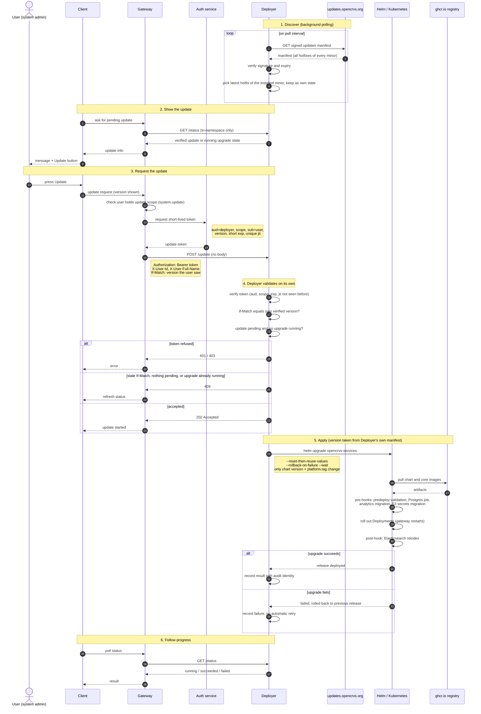

# Hotfix and security updates are applied by an in-cluster Deployer

A country learns about a security fix by following releases, and applies it by running `helm upgrade` itself. We will add a small Deployer service that checks `updates.opencrvs.org` for hotfix and security releases and reports one on an endpoint that only the gateway can reach. When an authorised user presses Update in the client, the Deployer runs the Helm upgrade. The Deployer only moves the core images of the `opencrvs-services` release, only within the installed minor version, and only when a user asks. It is installed as its own Helm release from the `opencrvs-addon` chart, so the upgrade that it runs never replaces it.

## How it works

1. The Deployer polls a signed file at `updates.opencrvs.org` (the updates manifest) that lists every hotfix and security release of each minor version. It verifies the file, finds the latest release of its own minor version, and keeps the result as its own state.
2. `GET /status` on the Deployer returns the verified update, or the state of the upgrade that is running. Only pods in the OpenCRVS namespace can reach it. The gateway fetches it, and the client shows a message and an Update button.
3. The button calls the gateway. The gateway checks that the user holds the update scope, for example the national system administrator. It then asks the auth service for a short-lived token for the Deployer and calls `POST /update`.
4. `POST /update` has no body. The caller cannot name a version, so the Deployer applies the version from its own verified manifest. The request carries `X-User-Id` and `X-User-Full-Name` for the audit record, and `If-Match`, the version the user was shown.
5. The Deployer runs `helm upgrade` for the `opencrvs-services` release and carries the previous values forward.

The diagram shows the same flow between the services. The status codes, the scope name and the headers are the ones proposed in "Details that we propose and have not confirmed".



The next diagram shows where the pieces run. The Deployer is a separate release in the same namespace as `opencrvs-services`.


## Decisions

**Scope is one release and patch versions.** The Deployer manages `oci://ghcr.io/opencrvs/opencrvs-services` and nothing else. It does not touch the dependencies chart or MOSIP, and it does not run a minor or major upgrade. Those stay manual, because they can carry migrations. The countryconfig image belongs to the country, and the Deployer does not change it.

**The Deployer calls Helm. It does not patch Deployments.** The chart runs hooks on every `helm upgrade`: predeploy validation, the Postgres on-deploy job, the analytics migration, the S3 secrets migration, and an Elasticsearch reindex afterwards. A patch of a Deployment skips all of them and leaves the Helm release out of step with the cluster.

**The Deployer is its own release, installed from the `opencrvs-addon` chart.** It runs in the namespace of `opencrvs-services` but outside that release, so the `helm upgrade` that it runs never replaces the Deployer's own pod. Helm runs inside the Deployer process. The Deployer does not upgrade itself, for the same reason: it cannot replace its own pod in the middle of a Helm run. Its image stays the same for each minor line, for example `v2.1` for every `v2.1.x`, and a country updates it with a manual `helm upgrade` of its own release when needed. `opencrvs-addon` is a generic chart for add-on applications such as Metabase, so what the Deployer needs is added to it as options that are off by default: a service account with RBAC, and a NetworkPolicy.

**The update is manual in v1.** Nothing is applied without a user pressing Update.

**The caller never names a version.** If `/update` accepted a version, the gateway or anything that held a valid token could choose what runs in the cluster. The Deployer decides, from a manifest it verified itself. `If-Match` is only a freshness check. The Deployer refuses the request when the version the user saw is no longer the version it would apply.

**The gateway proves the user to the Deployer with a token from the auth service.** The token has the audience `deployer`, the update scope, the user as subject, the version to apply, a short expiry and a unique id that the Deployer refuses to accept twice. A leaked user token cannot start an update, and a leaked update token works for one version for about a minute. The Deployer never calls the gateway to check anything, because the gateway restarts during an update.

**There is no migration guard.** A hotfix does not contain migrations, and the schema only gains things. A rollback to the previous release is then safe, because the old pods run against a database that has only grown. We do not carry a `requiresMigration` flag in the manifest and we do not require a backup before an update.

## Options that we rejected

**Flux, with the Helm and source controllers.** It has what the Deployer needs: semver selection, cosign verification, rollback on failure, and impersonation of a service account. We rejected it because the countries do not use GitOps, so each would install two controllers and their CRDs only for this. Flux also polls the registry, not our manifest, so a service that checks the manifest would still be needed.

**Argo CD with Image Updater.** It needs a GitOps setup. Image Updater changes the parameters of an Argo CD Application, and its documentation describes no way to trigger an update on demand.

**Keel.** It follows image tags in a registry and not a manifest. Its documentation describes no authentication for the approvals endpoint.

**Replicated KOTS.** It is the closest product to what we want, but it needs a license from a vendor portal and has its own admin console, not a button in OpenCRVS.

**Patching Deployments directly.** See the decision above. It would also be undone by the next `helm upgrade` that a country runs from its values file, which pins `platform.tag` to the old version.

**The Deployer inside the `opencrvs-services` chart.** The upgrade would replace the Deployer's own pod in the middle of the Helm run and could leave the release in `pending-upgrade`. A Deployer image that stays fixed for a minor line avoids this only while nothing in its pod template changes, and nothing would check that.

**A Kubernetes Job that runs Helm.** The Deployer would create a Job with a fixed name for each upgrade and read the Job status from the Kubernetes API, so the upgrade survives a Deployer restart. We do not need it while the Deployer is outside the release that it upgrades. It needs RBAC to create Jobs, and it does not reduce the Deployer's privilege, because the Job runs with the same power. It can be added later without changing `/status` or `/update`.

## Consequences

**The Deployer is the most privileged workload in the namespace.** Helm writes Secrets, Deployments, Jobs, NetworkPolicies and Traefik resources, and stores the release in Secrets. A compromised Deployer can read the namespace's secrets and run any image. Four controls carry this risk: a manifest that is verified before anything acts on it, the token above, no ingress route, and egress to the manifest host and the registry only. When `network_policy.enabled` is set, the `opencrvs-services` chart creates a default-deny NetworkPolicy for every pod in the namespace, and that includes the Deployer. The `opencrvs-addon` release therefore carries its own NetworkPolicy: egress to the Kubernetes API, the manifest host and the registry, and ingress from the gateway.

**Every country installs one more release.** The Deployer is not part of `opencrvs-services`, so a country adds a `helm upgrade --install` of the `opencrvs-addon` chart to its own deployment pipeline. A country that does not add it gets no update message and no button.

**The Deployer is not updated by the button.** A flaw in the Deployer itself is fixed by a manual `helm upgrade` of its own release, and the release process must tell the countries when to do it.

**A killed Deployer can leave the release half upgraded.** A node drain or an out-of-memory kill during a `helm upgrade` leaves the release in `pending-upgrade`, and the next upgrade is refused. The Deployer checks for this at startup, see the details below.

**A manual `helm upgrade` undoes a hotfix.** A country that deploys from its own values file keeps the old `platform.tag` there. After an update, the country must change its values file, or the next manual deploy goes back to the old version.

**A tag set on one service wins over `platform.tag`.** The image helper takes `<service>.image.tag` before `platform.tag`. A country that pins a core service will not get the hotfix for that service.

**A hotfix is not an image swap.** The hooks above run on every upgrade, so the Helm timeout must be generous.

**The rollback assumption is not checked by anything.** If a hotfix does carry a destructive or renaming migration, `--rollback-on-failure` starts the old pods against a changed schema, and nothing in the Deployer notices. The release process must hold the rule that a hotfix tag has no destructive migration.

**Helm is the only safety net.** There is no GitOps controller that reconciles the release afterwards, so rollback on failure and a lock that allows only one upgrade at a time have to be right.

## Not yet decided

- **Who owns the signing keys.** The manifest is only worth trusting if it is signed, and a forged one would run code in every country's registry. We have not decided who holds the private key, who may sign a release, how a key is rotated, or how a leaked key is revoked. The options are one offline key, a TUF-style root with delegated keys, and keyless signing from CI. Until this is decided, the trust model is incomplete.
- **The language of the Deployer.** Go can use the Helm SDK (`helm.sh/helm/v4`). TypeScript matches the rest of the repository but has to run the `helm` command line.
- **The signature of the manifest.** The format is not decided, and it follows from the choice about the signing keys. The fields, the hosting and the poll interval are proposed under "Details that we propose and have not confirmed".
- **How the auth service issues the token.** We have not checked whether it can issue a token with another audience. If it cannot, it needs an internal endpoint that only the gateway can call, and a key for these tokens that is not the key for user tokens.
- **Updates without a request to the internet.** Countries behind a proxy, with a mirror registry, or with no outside access are not described yet.

## Details that we propose and have not confirmed

- The Deployer applies its last verified manifest and does not fetch again when the user clicks.
- `POST /update` answers 202 when an upgrade starts, 409 when none is pending, one is running, or `If-Match` is stale, and 401 or 403 when the token is refused.
- The scope is called `system.update`.
- The audit identity is the subject of the token. `X-User-Id` and `X-User-Full-Name` are for display, and the Deployer limits and cleans the full name before it writes it to a log or an event.
- The manifest groups releases by minor version. The Deployer still checks that the version it applies has the installed minor, so a wrong entry in the manifest cannot move a cluster to another minor.
- Only the chart version and `platform.tag` change. The Deployer carries the running `countryconfig.image.tag` forward explicitly, because a new chart can have another default for it, and `/status` reports "not updatable" for a service that has its own tag.
- `/status` shows a blocked update with the reason, and shows when the live `platform.tag` is not the version that the Deployer applied last.
- A fixed name for the upgrade makes `POST /update` safe to repeat, and a failed upgrade is not retried until a person decides.
- Helm runs with `--reset-then-reuse-values`, `--rollback-on-failure` and `--wait`.
- A `mode` setting with `off` and `manual`, so that a later mode does not change the API.
- At startup, when the `opencrvs-services` release is in a `pending` state, the Deployer runs `helm rollback` and shows this in `/status`. The rollback assumption above makes this safe.
- The `opencrvs-addon` chart gets optional values for a service account with RBAC, a NetworkPolicy and a deployment strategy. They are off by default, so the add-ons that use the chart today do not change. The Deployer's release sets `ingress.enabled` to `false` and uses the `Recreate` strategy, so two Deployers never run at the same time.

**The updates manifest.** The Deployer reads `https://updates.opencrvs.org/manifest.json`. A detached signature sits next to it as `manifest.json.sig`, so the manifest stays plain JSON. The versions and dates below are examples.

```json
{
  "schemaVersion": 1,
  "generatedAt": "2026-10-29T09:00:00Z",
  "expiresAt": "2026-11-05T09:00:00Z",
  "minors": {
    "v2.1": {
      "releases": [
        { "version": "v2.1.1", "releasedAt": "2026-09-02T10:00:00Z", "type": "bugfix",
          "notes": "https://github.com/opencrvs/opencrvs-core/releases/tag/v2.1.1" },
        { "version": "v2.1.2", "releasedAt": "2026-10-20T10:00:00Z", "type": "security", "severity": "high",
          "notes": "https://github.com/opencrvs/opencrvs-core/releases/tag/v2.1.2" }
      ]
    },
    "v2.0": {
      "releases": [
        { "version": "v2.0.5", "releasedAt": "2026-08-14T10:00:00Z", "type": "bugfix", "yanked": true,
          "notes": "https://github.com/opencrvs/opencrvs-core/releases/tag/v2.0.5" },
        { "version": "v2.0.6", "releasedAt": "2026-08-18T10:00:00Z", "type": "bugfix",
          "notes": "https://github.com/opencrvs/opencrvs-core/releases/tag/v2.0.6" }
      ]
    },
    "v1.9": {
      "releases": [
        { "version": "v1.9.22", "releasedAt": "2026-07-01T10:00:00Z", "type": "security", "severity": "medium",
          "notes": "https://github.com/opencrvs/opencrvs-core/releases/tag/v1.9.22" }
      ]
    }
  }
}
```

- `minors` is keyed by minor version and lists every hotfix of that minor. The base release (`.0`) is not listed.
- `version` is the release tag. It is the chart version and the new `platform.tag`.
- `type` is `bugfix` or `security`. `severity` is set only for `security`, and it is what automatic updates would use later. `notes` is a link that the client shows next to the Update button.
- `yanked` marks a release that was pulled after it was published. The Deployer never offers it.
- `expiresAt` makes an old signed manifest useless. The Deployer treats an expired manifest as unverified, and `/status` reports it as stale. Without it, an old manifest could be served again to hide a new security fix.
- The Deployer reads the installed version from the live `platform.tag`, for example `v2.1.0`, and looks up `minors["v2.1"]`. It keeps the releases above the installed version that are not yanked and not prereleases, and offers the highest by semver. It does not rely on the order of the array. When the minor is not in the manifest, it offers nothing and `/status` reports the minor as unsupported.
- The Deployer polls every 6 hours, with jitter.
- A hotfix includes the earlier hotfixes of its minor, so the Deployer can go from `v2.1.0` to `v2.1.2` directly. This follows from the rule that a hotfix has no migrations.
- The manifest pins a version number and not the content of the images. The chart references images by tag, so pinning digests needs its own decision.

## Later

Automatic application of security fixes is not part of this decision. It would need `severity` in the manifest, a maintenance window, a backup that has succeeded, and a signing and rollback process that has run in production.
