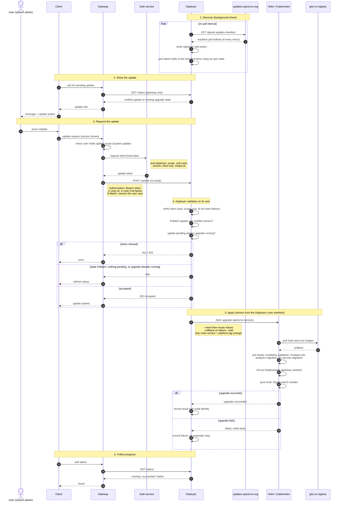
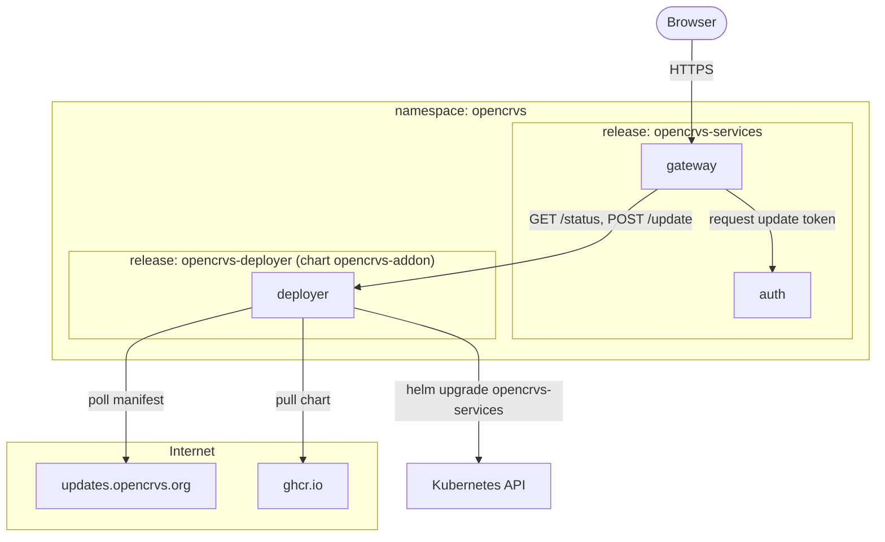

# An in-cluster Deployer applies hotfix and security updates

Today, a country must watch the OpenCRVS releases to find a security fix. Then the country runs `helm upgrade` by hand.

This ADR adds a Deployer service. The Deployer checks `updates.opencrvs.org` for new hotfix versions. The gateway reads the result from the Deployer, and the client shows an Update button. When an authorised user presses the button, the Deployer runs `helm upgrade`. It changes only the `opencrvs-services` Helm release, only to a hotfix version of the installed minor version, and only when a user asks.

A *Helm release* is an installation of a chart, such as `opencrvs-services`. A *hotfix version* is a patch version, such as `v2.1.2`.

## How it works

The diagram shows the flow. The status codes, the scope name and the headers are proposals. See "Proposed details".



The next diagram shows where the parts run. The Deployer is a separate Helm release in the same namespace as `opencrvs-services`.



## Decisions

**One Helm release, hotfix versions only.** The Deployer manages `oci://ghcr.io/opencrvs/opencrvs-services` and nothing else. It does not change the dependencies chart, MOSIP or the countryconfig image. The country owns the countryconfig image. The Deployer does not run a minor or major upgrade, because these upgrades can have migrations. A country does them by hand.

**The Deployer runs Helm. It does not patch Deployments.** The chart runs hooks on each `helm upgrade`: predeploy validation, the Postgres on-deploy job, the analytics migration, the S3 secrets migration and an Elasticsearch reindex. A patch of a Deployment skips these hooks and leaves the Helm release out of step with the cluster. The hooks take time, so the Helm timeout must be long.

**The Deployer is its own Helm release.** It comes from the `opencrvs-addon` chart and runs in the namespace of `opencrvs-services`, but outside that Helm release. Helm runs inside the Deployer process. Because of this, the `helm upgrade` never replaces the Deployer pod. For the same reason, the Deployer does not update itself. The Deployer image stays the same for each minor version, for example `v2.1` for each `v2.1.x`.

**The caller never names a version.** `POST /update` has no body. If it accepted a version, the gateway or a holder of a valid token can choose the code that runs in the cluster. Instead, the Deployer applies the version from the manifest that it verified itself. `If-Match` carries the version that the user saw, as a freshness check. The Deployer does not accept the request when this version is not the version that it applies.

**The gateway proves the user with a token from the auth service.** The token names the user and the version, works once and has a short life. A leaked user token cannot start an update. A leaked update token works for one version for about one minute. The Deployer never calls the gateway to check a user, because the gateway restarts during an update.

**There is no migration guard.** A hotfix version has no destructive migration. It can add to the schema, but it cannot remove or rename data. A rollback is then safe, because the old pods run against a database that only grew. The manifest has no `requiresMigration` flag, and an update does not need a backup. The release process must keep this rule, because nothing in the Deployer checks it. If a hotfix version breaks the rule, `--rollback-on-failure` starts old pods against a changed schema.

**The update is manual in v1.** The Deployer applies nothing until a user presses Update. Automatic updates are not part of this ADR. They need `severity` in the manifest, a maintenance window, a successful backup and a proven way to sign versions and to roll back. A `mode` option (`off` or `manual`) lets a later mode keep the same API.

## Rejected options

**Flux, with the Helm and source controllers.** Flux has semver selection, cosign verification, rollback and service account impersonation. But the countries do not use GitOps, so each country must install two controllers and their CRDs only for this feature. Flux also watches the registry, not the manifest, so the project still needs a service that reads the manifest.

**Argo CD with Image Updater.** It needs GitOps. Its documentation shows no way to start an update on demand.

**Keel.** It follows image tags in a registry, not a manifest. Its documentation shows no authentication for the approvals endpoint.

**Replicated KOTS.** It is the closest product. But it needs a license from a vendor portal and has its own admin console, not a button in OpenCRVS.

**The Deployer in the `opencrvs-services` chart.** Each update replaces the Deployer pod during the Helm run. This can leave the Helm release in `pending-upgrade`. A fixed Deployer image prevents this only while the pod template does not change, and nothing checks that.

**A Kubernetes Job that runs Helm.** The Deployer creates a Job for each upgrade and reads the Job status from the Kubernetes API. The upgrade then survives a Deployer restart. The Deployer does not need this now. The Job also needs RBAC and has the same power as the Deployer, so it does not reduce the risk. A later version can add it without a change to `/status` or `/update`.

## Consequences

**The Deployer is the most privileged workload in the namespace.** Helm writes Secrets, Deployments, Jobs, NetworkPolicies and Traefik resources, and stores the Helm release in Secrets. A compromised Deployer can read the secrets of the namespace and run any image. Four controls reduce the risk: the verified manifest, the token, no ingress route, and egress only to the manifest host and the registry.

**The Deployer needs its own NetworkPolicy.** When `network_policy.enabled` is set, the `opencrvs-services` chart creates a default-deny NetworkPolicy for each pod in the namespace. The Deployer is one of these pods. The Deployer Helm release must allow egress to the Kubernetes API, the manifest host and the registry, and ingress from the gateway.

**A country installs and updates the Deployer by hand.** A country adds `helm upgrade --install` for the `opencrvs-addon` chart to its deployment pipeline. Without it, the client shows no update message. The Update button does not update the Deployer, so the release process must tell each country when to update it.

**A killed Deployer can leave a Helm release half upgraded.** A node drain or an out-of-memory kill during `helm upgrade` leaves the Helm release in `pending-upgrade`, and Helm refuses the next upgrade. Proposal: the Deployer runs `helm rollback` for such a Helm release at startup and shows this in `/status`. The migration rule makes this rollback safe.

**A manual `helm upgrade` undoes a hotfix.** A country that deploys from its own values file keeps the old `platform.tag` there. The country must change the file after an update. If not, the next manual deploy goes back to the old version.

**A tag on one service wins over `platform.tag`.** The image helper uses `<service>.image.tag` before `platform.tag`. A country that pins a core service gets no hotfix for that service.

**Helm is the only safety net.** No GitOps controller reconciles the Helm release after the upgrade. Rollback on failure and a lock that allows one upgrade at a time must work.

## Not yet decided

- **Who signs the manifest, and the signature format.** The manifest is trustworthy only if the owner signs it. A forged manifest can change what runs in each country. This ADR does not decide who holds the private key or who can sign a version. It does not decide how to rotate a key or revoke a leaked key. The options are one offline key, a TUF-style root with delegated keys, or keyless signatures from CI. Until then, the trust model is not complete.
- **The language of the Deployer.** Go can use the Helm SDK (`helm.sh/helm/v4`). TypeScript matches the rest of the repository, but it must run the `helm` command line.
- **How the auth service issues the token.** The ADR does not check if the auth service can issue a token with another audience. If it cannot, it needs an internal endpoint that only the gateway can call. It also needs a key for these tokens that is not the key for user tokens.
- **Updates without access to the internet.** This ADR does not cover a country behind a proxy, with a mirror registry or with no outside access.

## Proposed details

The team has not confirmed these details.

- The audit identity is the subject of the token. `X-User-Id` and `X-User-Full-Name` are only for display. The Deployer limits the length of the full name and removes unsafe characters before it writes the name to a log or an event.
- Only the chart version and `platform.tag` change. The Deployer keeps the current `countryconfig.image.tag`, because a new chart can have a different default.
- `/status` shows a blocked update and the reason. It reports when the live `platform.tag` is not the version that the Deployer applied last. It reports "not updatable" for a service that has its own tag.
- A fixed name for the upgrade makes `POST /update` safe to repeat.
- The `opencrvs-addon` chart gets optional values for a service account with RBAC, a NetworkPolicy and a deployment strategy. They are off by default, so the current add-ons do not change. The Deployer Helm release sets `ingress.enabled` to `false` and uses the `Recreate` strategy. Because of this, two Deployers never run together.

### The updates manifest

The Deployer reads `https://updates.opencrvs.org/manifest.json` every 6 hours, with jitter. A detached signature in `manifest.json.sig` keeps the manifest plain JSON. The values below are examples.

```json
{
  "schemaVersion": 1,
  "expiresAt": "2026-11-05T09:00:00Z",
  "minors": {
    "v2.1": {
      "hotfixes": [
        { "version": "v2.1.1", "releasedAt": "2026-09-02T10:00:00Z", "type": "bugfix" },
        { "version": "v2.1.2", "releasedAt": "2026-10-20T10:00:00Z", "type": "security", "severity": "high" }
      ]
    },
    "v2.0": {
      "hotfixes": [
        { "version": "v2.0.5", "releasedAt": "2026-08-14T10:00:00Z", "type": "bugfix", "yanked": true },
        { "version": "v2.0.6", "releasedAt": "2026-08-18T10:00:00Z", "type": "bugfix" }
      ]
    }
  }
}
```

- `minors` has one key for each minor version. It lists each hotfix version of that minor version, but not the base version (`.0`).
- `version` is the tag. It is the chart version and the new `platform.tag`.
- `type` is `bugfix` or `security`. Only `security` has `severity`, which automatic updates can use later.
- `yanked` marks a version that OpenCRVS withdrew after publication. The Deployer never offers it.
- `expiresAt` makes an old signed manifest useless. The Deployer treats an expired manifest as not verified, and `/status` reports it as stale. Without it, an attacker can serve an old manifest to hide a new security fix.

The Deployer selects an update in these steps:

1. It reads the installed version from the live `platform.tag`, for example `v2.1.0`, and looks up `minors["v2.1"]`.
2. It ignores yanked versions, prereleases and versions that are not higher than the installed version.
3. It offers the highest version that is left, by semver, not by array order.
4. It checks that this version has the installed minor version, so a wrong entry cannot move a cluster to another minor version.

If `minors["v2.1"]` does not exist, the Deployer offers nothing and `/status` reports the minor version as unsupported. The Deployer applies its last verified manifest. It does not fetch the manifest again when the user presses Update.

The Deployer assumes that a hotfix version includes the earlier hotfix versions of its minor version. It can then go from `v2.1.0` to `v2.1.2` directly.

The manifest pins a version number, not the content of the images. The chart references images by tag, so pinned digests need a separate decision.
